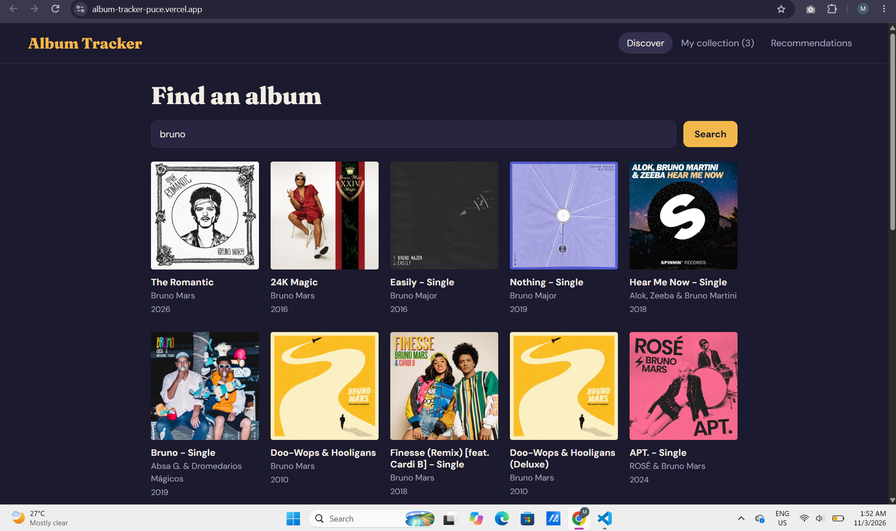
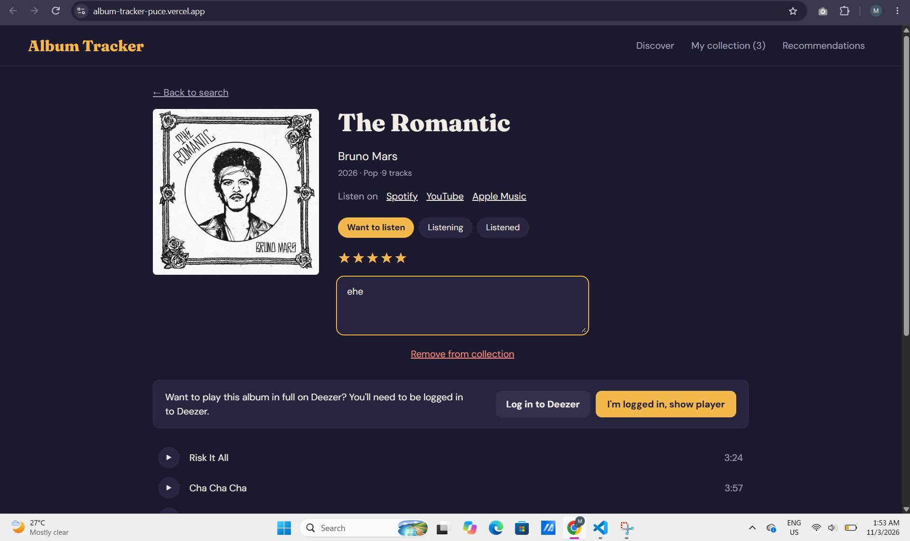
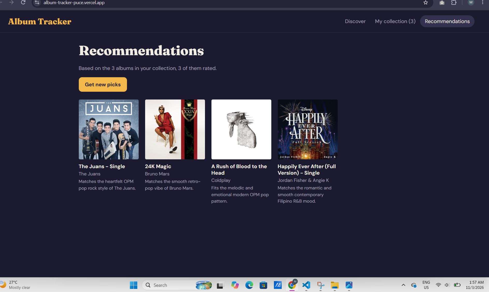

# Album Tracker

Album Tracker is a web-based application that allows users to search for music albums, explore album details, listen to track previews, and manage their personal music collection. It also provides AI-powered album recommendations based on the user's saved albums and ratings.

## Live Website

Paste your Vercel website link here.

## for Features

- Search for albums and artists.
- View album details and track listings.
- Play 30-second music previews.
- Play full albums through Deezer when available.
- Save albums to a personal collection.
- Add ratings, notes, and listening statuses.
- Filter and sort saved albums.
- Get AI-powered album recommendations.

## Tech Stack

- React
- Vite
- Context API
- iTunes Search API
- Deezer
- Google Gemini API
- Vercel

## Privacy & Disclaimer

The AI recommendation feature sends album information, such as album titles, artists, ratings, and listening statuses, to the Google Gemini API to generate recommendations. Personal notes are not included.

This project is not affiliated with or officially endorsed by Apple, Spotify, Deezer, or Google.

## How to Runnn Locally


## How to Run Locally

1. Clone this repository:
   ```bash
   git clone https://github.com/reambonanzamaryrose57-max/album-tracker.git
   ```

2. Go to the project folder:
   ```bash
   cd album-tracker
   ```

3. Install dependencies:
   ```bash
   npm install
   ```

4. Create a `.env.local` file in the project root and add:
   ```env
   GEMINI_API_KEY=your_actual_api_key
   ```

5. Start the development server:
   ```bash
   npm run dev
   ```


## Screenshots





a